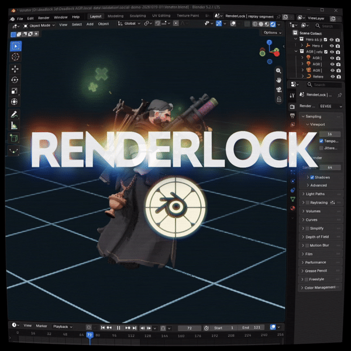

# RenderLock

**Bring Deadlock replay performances into Blender.**

  

  

Choose a recording, characters and a tick range. RenderLock exports an animated
Blender scene for cinematics, edits and stills, with coverage reports for optional
cloth, effects and character lighting. A separately downloaded map can be appended
and aligned in the same scene.

**Current source: 0.3.0b18 · Windows x64 · character beta.** The portable ZIP
includes Python, the asset converter and helper tools. Install Blender separately
and supply your own Deadlock installation and replay.

RenderLock works offline from replay and installed asset files. You do not need
to launch Deadlock or change its Steam launch options. Game updates and older
recordings can still require compatibility work.

[Quick start](#quick-start) · [Features](#features) · [Guides](#guides) ·
[Compatibility](#compatibility) · [Support](#support) · [Credits](#credits)

## Quick start

1. Download **RenderLock-0.3.0b18-Windows-x64.zip**, or the newer Windows ZIP on
   [Releases](https://github.com/cravvnn/RenderLock/releases/latest), and extract it
   completely. Keep the runtime, tools and other files beside **RenderLock.exe**.
2. Open **RenderLock.exe**. In **Setup**, select Blender and your Deadlock folder.
   Blender 5.2.1 LTS is the tested installation; the downloaded-map workflow needs
   Blender 5.2 or newer. The converter and helper paths are discovered from the ZIP.
3. In **Export**, select a `.dem`, inspect it and choose a character for a short
   preview. Use **Standard materials** and turn off optional effects, cloth and map
   for the first animation check.
4. Choose a new `.blend` output and export. Leave **Allow partial export / movement
   placeholders** off for a full character-animation check.
5. Read the completion message and coverage report, then open the `.blend` in
   Blender. Add the optional features you need after that preview succeeds.

The [user guide](docs/USER_GUIDE.md) covers the pages, output files, saved packages
and cache. For a stopped export, start with [troubleshooting](docs/TROUBLESHOOTING.md).

## Features

- **Recorded character animation.** Export selected player lifetimes, movement
  and skeletal poses at original world positions. Compatible transformations keep
  their separate model tracks under one player root.
- **Characters and cameras.** Choose characters by name and use an overview or
  a fitted follow camera. Imported character objects have readable hero names;
  some generated helper objects retain utility names.
- **Materials and textures.** Converted character textures are packed into the
  scene. Optional static emission/glass repairs have their own documented limits.
- **Cloth and effects.** Export supported approximate cloth and recorded particle
  layers; unavailable features remain visible in coverage. Support varies by
  model, recorded history and effect tree.
- **Character looks.** Choose Standard materials, partial Source lighting, or
  Elagrimm + Source. The Elagrimm library is a separate download; these looks do
  not reproduce every game shader or lighting effect.
- **Map in the final scene.** Download the separate map, include it on **Map**, and
  let RenderLock append and align it. Relink textures and cut the map manually.
- **Recovery and reuse.** Recognized failures offer specific, explicit retry
  choices. Verified generated assets can be reused between exports, and failed
  exports try to retain a support ZIP beside the normal logs.

## Guides

Start with the [documentation index](docs/README.md).

| What you need | Guide |
| --- | --- |
| Setup, character selection, output files and saved packages | [User guide](docs/USER_GUIDE.md) |
| Source lighting, Elagrimm and material options | [Lighting and materials](docs/LIGHTING.md) |
| Map download, alignment, textures and manual cutting | [Map workflow](MAP_WORKFLOW.md) |
| Supported cloth, coverage and cloth-only recovery | [Cloth / secondary motion](CLOTH_WORKFLOW.md) |
| Failed exports, support ZIPs and compatibility errors | [Troubleshooting](docs/TROUBLESHOOTING.md) |
| Inspection, conversion and explicit partial flags | [Command-line guide](docs/CLI.md) |
| App updates and interrupted-update recovery | [Updating RenderLock](UPDATING.md) |
| Source setup, helper builds and packaging | [Building](docs/BUILDING.md) |

## Compatibility

RenderLock is a beta. A successful export does not establish full game-render
parity or support for every hero ability, cloth layout or replay revision.
Replay, model, rig and animation data must agree. Optional lighting has additional
resource and selected-material checks; a compatibility check reporting resources
ready is not a promise that a whole export will succeed.

Partial choices have different scopes:

| Choice | What you accept |
| --- | --- |
| **Keep supported cloth if some cloth is unavailable** | Omitted/failed cloth, while models and character animation stay strict |
| **Accept partial lighting limits for this export** | Artistic/reference lighting limits, while character data stays strict |
| **Allow partial export / movement placeholders** | Broader compromises, including unavailable models or animation |
| A specific recovery choice | Only the changes described by that choice; closing recovery never retries |

The external map is static, can differ from a replay's map revision, and supplies
no Source-lighting data or cloth collision. Its textures stay external until you
relink or pack them yourself.

Native Linux work is on a separate
[experimental support branch](https://github.com/cravvnn/RenderLock/blob/feature/linux-support-20261024/LINUX.md).
There is no supported Linux release archive yet. The separate branch's fixes and
cloth-verifier changes are not part of the Windows b16 release.

## Application updates

Windows portable releases from b4 include **Updates**. Check the release notes,
choose **Download update**, then **Install and restart** when your job is finished.
Startup checks fetch metadata only and can be disabled. Settings, exports and the
shared asset cache are retained. See [updating and recovery](UPDATING.md).

The application uses Kara's original artwork and interface design. On Windows,
verified Oracle/Pulp display fonts can be loaded privately from your selected
game installation; fonts are not bundled or installed into Windows. Missing fonts
fall back to Segoe UI. [Setup details](docs/USER_GUIDE.md#interface-fonts)

## Development

Use 64-bit Python 3.12+ and a virtual environment. Source development also needs
the appropriate native extractor and external converter/helper tools. See
[Building](docs/BUILDING.md) and [Contributing](CONTRIBUTING.md) before starting.
The Windows portable ZIP is the normal ready-to-run download.

## Support

[Report an issue](https://github.com/cravvnn/RenderLock/issues) or join the
[Deadlock Editing Discord](https://discord.gg/deadlockediting). Include the RenderLock and
Blender versions, installed game build, replay/match ID, selected ticks and the
support ZIP or exact error. The recovery window provides **Open diagnostics**
and **Copy path**; logs normally live in `%LOCALAPPDATA%\RenderLock\logs`.

Review diagnostics before sharing: local paths and replay names can remain in
them. Do not post replay/game assets you do not have permission to distribute.
[What to send](docs/TROUBLESHOOTING.md#reporting-an-issue)

## Credits

Maintained by [Cravvnn](https://github.com/cravvnn), with UI design and artwork by
[Kara](https://github.com/officialkaraig-ux). See [Credits](CREDITS.md) for the asset,
animation, shader, cloth and community projects behind RenderLock.

RenderLock source uses the [MIT license](LICENSE). Bundled dependencies and
third-party shader libraries retain their own terms; see [Third-party notices](THIRD_PARTY.md).
Game assets and third-party shader libraries are not included in the application ZIP.

## Releases

- [Downloads and published notes](https://github.com/cravvnn/RenderLock/releases)
- [Complete changelog](CHANGELOG.md)
- [Map download](https://maps.allevilmc.com/download)
